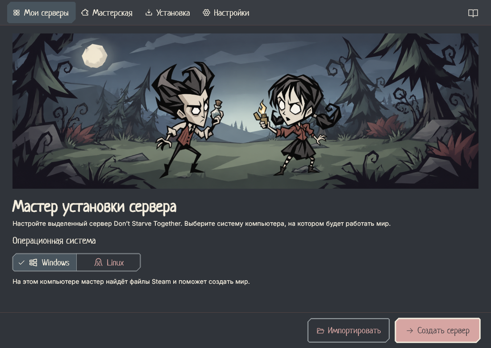

# DST Server Launcher

Независимый desktop-лаунчер для официального **Don't Starve Together Dedicated Server**.
Windows 10/11 x64 и Linux Desktop x64. Русский / English, тёмная / светлая тема.



## Скачать

Готовые сборки находятся в [GitHub Releases](https://github.com/kantaevsherhan/dst-server-launcher/releases).
Windows: распакуйте **весь** portable ZIP и запустите `dst_server_launcher.exe`, либо используйте setup.exe.
Linux: распакуйте tar.gz и запустите `./launch.sh`. Сборка требует glibc ≥ 2.35 и GTK 3.
Подготовка дистрибутива: [Debian, Ubuntu, Mint, Manjaro, Fedora](docs/setup-linux.md).

## Первая игра

1. Выберите Windows или Linux и нажмите «Создать сервер». Для текущей ОС откроется настройка мира. Для другого компьютера можно сохранить инструкцию и, для Linux, скрипт SteamCMD.
2. Установите **Dedicated Server, Steam app 343050**, через «Библиотека → Инструменты».
   На Linux также доступны команды установки SteamCMD по дистрибутивам.
3. Задайте имя, 1–64 места, режим и размер мира; при необходимости включите пещеры.
4. Добавьте Workshop URL/ID (мод или коллекция). Проверьте описание автора на совместимость.
5. Получите [Klei token](https://accounts.klei.com/account/game/servers?game=DontStarveTogether), вставьте его и проверьте порты.
6. Проверьте конфиги → создайте файлы → откройте управление → «Запустить».
7. Следите за Master и Caves в консоли. Проверьте подключение через список серверов DST.
8. Для остановки используется `c_shutdown(true)`; принудительное завершение требует подтверждения.

Приложение не запрашивает пароль Steam и не устанавливает службы или правила firewall автоматически.
Закрытие с работающими серверами предлагает остановку, свёрнутую работу или отмену.

## Реализовано

- Девять шагов настройки, сохраняемый черновик без секретов; несколько независимых профилей.
- Поиск Steam и нескольких библиотек, manifest 343050 и проверка реального x64 binary; ручной путь.
- Steam Client на Windows **и Linux**; команды SteamCMD для Debian/Ubuntu/Mint/Manjaro/Fedora.
- Генерация cluster/server/worldgen/modoverrides; отдельные порты и процессы Master/Caves.
- Импорт Workshop metadata через Valve API; коллекции разворачиваются в проверенные DST-моды.
- Запуск/остановка/рестарт, фильтры и поиск логов, ротация на диске, маскировка секретов.
- Локальная UDP-диагностика, ZIP-бэкапы остановленных миров, предпросмотр и защитная копия перед restore.
- Импорт остановленного кластера копированием; диагностический экспорт без секретов и логов.
- Локальные шрифты/иллюстрация, RU/EN ARB, keyboard navigation, desktop packaging и CI.

## Ограничения версии 0.1

Это первая публичная версия. Реальная игра требует установленного сервера и собственного Klei token.
Полный живой сценарий с друзьями и всеми пятью Linux-дистрибутивами нужно проверить по [чеклисту](docs/testing.md).
Статус процесса и локальный bind **не доказывают** доступность из интернета.
Онлайн/ping показываются как недоступные, если источник не подключён.
Нет постоянной фоновой службы/автозапуска, UPnP, удалённого probe или автоматического редактирования firewall.
Фон означает работающий свёрнутый GUI; при его аварийном завершении DST получает `-monitor_parent_process`.
Параметры модов используются по умолчанию; совместимость проверяйте у автора.
Каталог по названию открывается в Steam, а не скрейпится. Нет обещания автоматического определения конфликтов.
Доступны проверенные базовые world presets и размер; непроверенные resource/boss keys не генерируются.
Миры после создания не регенерируются через GUI: создайте другой профиль.
Обновление/verify через Steam выполняется пользователем в официальном клиенте.
Повторное открытие обнаруживает ранее записанные процессы и блокирует дубли; reattach stdin внешнего процесса недоступен.
Пароль мира и shard key хранятся в профиле с правами пользователя; Klei token — только в cluster_token.txt.
Бэкапы не содержат стандартные секреты, но пользовательские файлы модов следует проверять перед передачей другим людям.

## Разработка

Flutter **3.47.7 stable**, Dart **3.13.5** (фиксируется в CI).
Windows: Visual Studio Build Tools, workload Desktop development with C++, Windows SDK, CMake.
Linux: clang, cmake, ninja-build, pkg-config, libgtk-3-dev, liblzma-dev, libx11-dev, libxi-dev (либо аналоги своего дистрибутива).

```sh
flutter pub get
dart format lib test integration_test
flutter analyze
flutter test
flutter run -d windows # или -d linux в Linux
flutter build windows --release # в Windows
flutter build linux --release   # в Linux
```

Кросс-компиляция Linux из Windows не заявлена. GitHub Actions собирает обе платформы на соответствующих ОС.
Если Windows запрещает создание symlink, после `pub get` можно запустить
`scripts/windows/local-junctions.ps1` и сборку с `--no-pub`; скрипт не меняет системные настройки безопасности.

## Документация

[Архитектура](docs/architecture.md) · [Дизайн](docs/design.md) · [Windows](docs/setup-windows.md) ·
[Linux](docs/setup-linux.md) · [Безопасность](docs/security.md) · [Проблемы](docs/troubleshooting.md) ·
[Проверки](docs/testing.md) · [Релиз](docs/release.md) · [Правила по ролям](docs/skills.md).

MIT. Не связан с Klei Entertainment или Valve. Игровые файлы не распространяются.

## Steam subscriptions and headless Linux

Open **Workshop → My Steam subscriptions** to browse DST subscriptions synced by the local Steam client. When editing a world, choose a mod with **+**. On shared PCs, select the local Steam account. The list can include client-only items. Restart the stopped world after changing its mod selection.

For Linux Server over SSH, download `install-dst-server.sh` from the release. See [Linux setup](docs/setup-linux.md) for dependency and shard commands.
